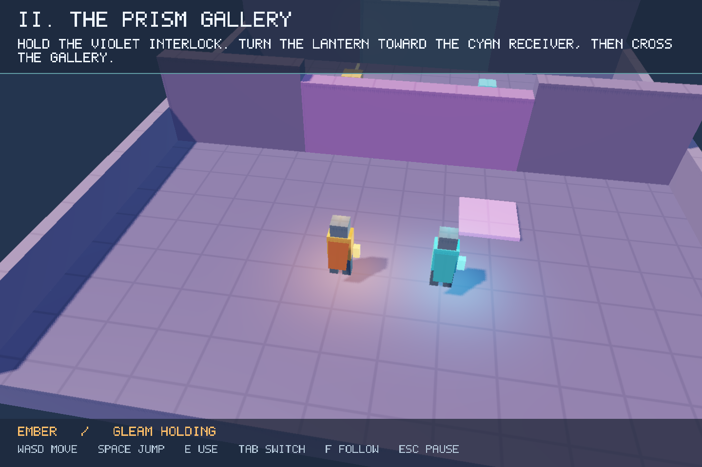

# Emberfall

Emberfall is a C++23 engine and scene workshop for *The Lantern Reach*. Two explorers work through a shuttered observatory by holding relays, aiming a lantern, and crossing a powered ferry. Play solo by switching explorers or invite a second player over IPv4.



## Run the preview

Install CMake 3.25+, Ninja, Python 3.10+, a C++23 compiler, Vulkan 1.3 headers and loader, and glslang. On macOS arm64, use MoltenVK. On Linux x86-64, use a Vulkan-capable GPU driver and SDL's X11 development dependencies. The diagnostic package bundles the Vulkan loader and MoltenVK on macOS.

```sh
make doctor
make test FRONTEND=OFF BUILD=build-core
make game
make editor SCENE=assets/levels/01-aperture.scene
make package-game
```

WASD moves, Space jumps, E uses a mechanism, Tab switches explorers, and F toggles following. The gamepad bindings and LAN instructions are in the [play guide](docs/PLAY.md). For editor controls, see the [workshop guide](docs/WORKSHOP.md).

## Engine notes

The runtime advances a generation-checked archetype world at 60 Hz. The Vulkan renderer records an original directional shadow pass, opaque HDR lighting, and a display pass. The editor submits validated scene transactions and spawns an isolated play world. A versioned catalog tracks scene and prefab dependencies through cooking. The network host owns puzzle state and publishes bounded quantized snapshots.

- [Architecture and source walkthroughs](docs/ARCHITECTURE.md)
- [Engineering studies](docs/STUDIES.md)
- [Architecture decisions](docs/DECISIONS.md)
- [Editable diagrams and SVGs](docs/DIAGRAMS.md)
- [Experiment plan](docs/EXPERIMENT_PLAN.md) and [reproduction commands](docs/REPRODUCIBILITY.md)
- [Methods and provenance](docs/BIBLIOGRAPHY.md)
- [Measured portability diagnostic](docs/DIAGNOSTICS.md)
- [Current build and gate status](docs/BUILD_STATUS.md) and [capability coverage](docs/COVERAGE.md)

The preview supports complete scripted runs of all three levels. The Linux hardware acceptance campaign and full engine feature set remain incomplete.
